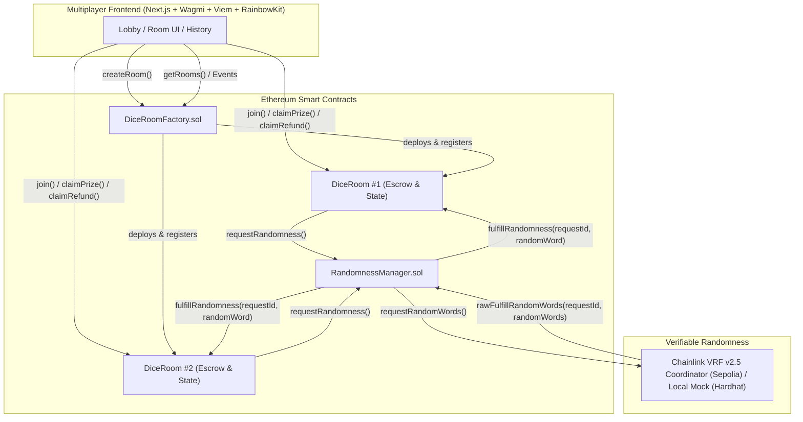
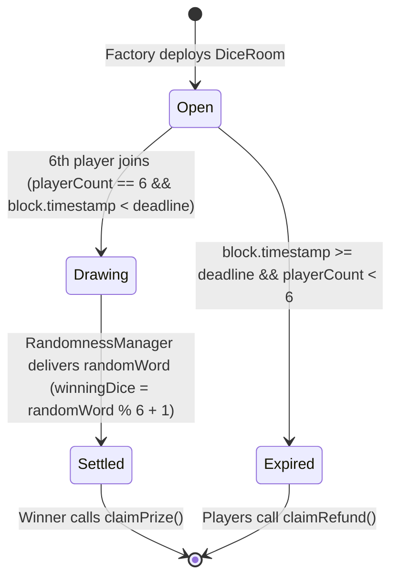
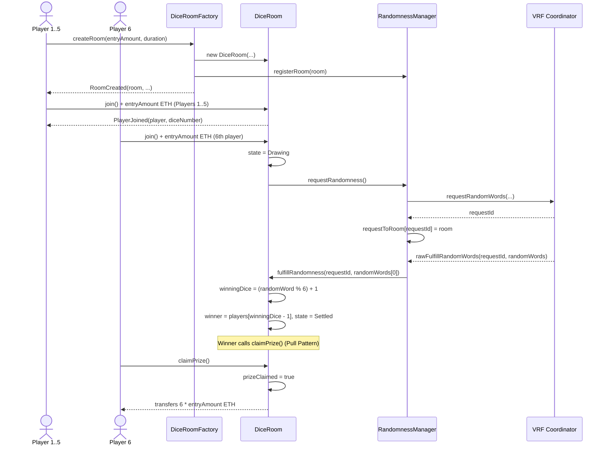
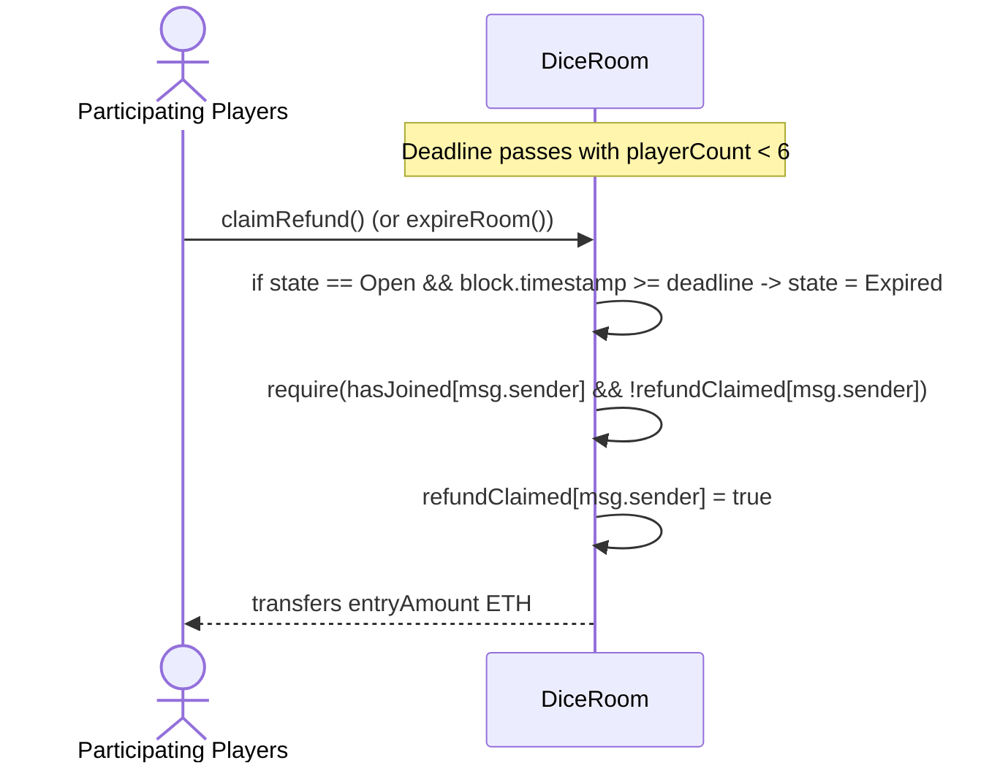

# System Architecture: Decentralized Multiplayer Dice Protocol

## 1. High-Level Architecture

The protocol separates **room orchestration**, **escrow/game logic**, and **verifiable randomness** into three distinct contract layers, paired with a Next.js + Wagmi/Viem frontend.



> [!NOTE]
> **Deployment Strategy**: We start with standard `new DiceRoom(...)` deployments from `DiceRoomFactory` for clarity and straightforward verification. Minimal proxies (EIP-1167 `Clones`) can be explored as an optional gas optimization after the core system is tested and working.

---

## 2. Core Smart Contracts

### 2.1 `DiceRoomFactory.sol`
- **Role**: Entry point for room creation and discovery.
- **State**:
  - `address[] public rooms` — ordered list of all deployed `DiceRoom` addresses.
  - `mapping(address => bool) public isRegisteredRoom` — O(1) verification that a room was created by this factory.
  - `RandomnessManager public immutable randomnessManager` — shared randomness router.
- **Key Functions**:
  - `createRoom(uint256 entryAmount, uint256 duration) external returns (address room)`
  - `getRoomsCount() external view returns (uint256)`
  - `getRooms(uint256 offset, uint256 limit) external view returns (address[] memory)`

### 2.2 `DiceRoom.sol`
- **Role**: Self-contained escrow and state machine for one 6-player dice game.
- **Key State**:
  - `uint256 public immutable entryAmount`
  - `uint256 public immutable deadline`
  - `RoomState public state` (`Open`, `Drawing`, `Settled`, `Expired`)
  - `address[6] public players` (index `0..5` corresponds to dice numbers `1..6`)
  - `uint8 public playerCount`
  - `mapping(address => bool) public hasJoined`
  - `uint8 public winningDice` (`1..6`, `0` if unset)
  - `address public winner`
  - `bool public prizeClaimed`
  - `mapping(address => bool) public refundClaimed`
- **Access Control**:
  - `join()`: Public payable while `state == Open` and `block.timestamp < deadline`, exact `msg.value == entryAmount`, `!hasJoined[msg.sender]`, `playerCount < 6`.
  - `fulfillRandomness(uint256 requestId, uint256 randomWord)`: Restricted to `randomnessManager`.
  - `claimPrize()`: Restricted to `winner` when `state == Settled && !prizeClaimed`.
  - `expireRoom()` / `claimRefund()`: Allowed when `block.timestamp >= deadline` and `state == Open` (transitions to `Expired`), and `hasJoined[msg.sender] && !refundClaimed[msg.sender]`.

### 2.3 `RandomnessManager.sol`
- **Role**: Bridges `DiceRoom` instances to Chainlink VRF without requiring each room to hold its own VRF subscription.
- **Why a Separate Manager?**
  - Chainlink VRF requires funding a subscription and authorizing consumer contracts. Having `DiceRoomFactory` deploy a new `DiceRoom` per game means new rooms cannot be pre-authorized on a VRF subscription without manual or factory-admin intervention.
  - Instead, **only `RandomnessManager`** is registered as the VRF consumer. `DiceRoomFactory` registers each newly created `DiceRoom` with `RandomnessManager` (`registerRoom(address room)`).
- **Request-to-Room Correlation**:
  - `mapping(uint256 => address) public requestToRoom`
  - `mapping(address => bool) public authorizedRooms`

---

## 3. Room State Machine



---

## 4. End-to-End Sequence Flows

### 4.1 Happy Path: 6 Players Join, VRF Settles, Winner Claims



### 4.2 Expiration & Refund Path



---

## 5. Security Model & Financial Invariants

1. **Pull-over-Push Withdrawals**: Neither `fulfillRandomness` nor `expireRoom` sends ETH. Winners and refund claimants pull their own funds via `claimPrize()` and `claimRefund()`, protected by Checks-Effects-Interactions (CEI) and OpenZeppelin `ReentrancyGuard`.
2. **Solvency Invariant**: At all times:
   - In `Open` or `Drawing`: `address(room).balance == playerCount * entryAmount`
   - In `Settled`: `address(room).balance == (prizeClaimed ? 0 : 6 * entryAmount)`
   - In `Expired`: `address(room).balance == (playerCount - refundedCount) * entryAmount`
3. **Mutual Exclusion**: A room in `Settled` can never transition to `Expired`, and vice versa.
4. **No Stale VRF Fulfillment**: `RandomnessManager` clears `requestToRoom[requestId]` upon fulfillment and `DiceRoom` checks `state == Drawing` before settling.

---

## 6. Repository Layout

```text
Dice_game/
├── contracts/          # Hardhat workspace (Solidity, TypeScript tests, deploy scripts)
├── frontend/           # Next.js + TypeScript + Wagmi/Viem/RainbowKit
├── deployments/        # Local & Sepolia deployment artifacts (addresses, ABIs)
├── docs/               # PRD, Architecture, Learning Log, Test Report
├── .github/workflows/  # CI for Hardhat tests & frontend build
├── .env.example        # Environment variable template
└── README.md           # Project overview & quickstart
```
